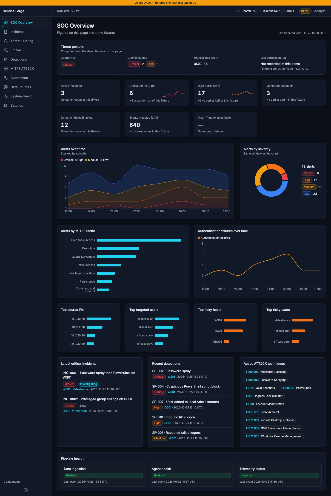
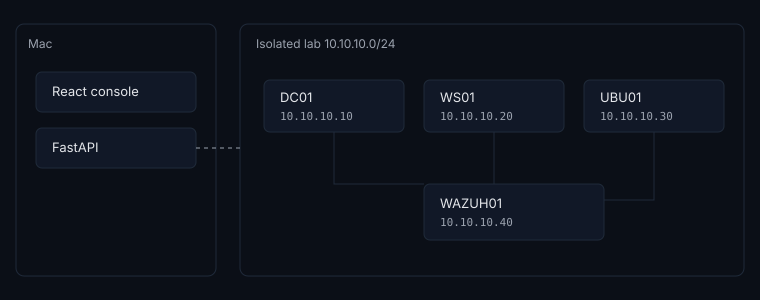

# SentinelForge

A SOC analyst console and detection-as-code pipeline built on Wazuh.

[](https://github.com/The1keyy/enterprise-siem-threat-hunting-lab/actions/workflows/detections.yml)
[](https://github.com/The1keyy/enterprise-siem-threat-hunting-lab/actions/workflows/app.yml)
[](https://github.com/The1keyy/enterprise-siem-threat-hunting-lab/actions/workflows/logtest.yml)
[](https://github.com/The1keyy/enterprise-siem-threat-hunting-lab/actions/workflows/secrets.yml)
[](https://github.com/The1keyy/enterprise-siem-threat-hunting-lab/actions/workflows/scripts.yml)

[Live demo](https://PASTE_MY_VERCEL_URL_HERE)

**Status: lab validation in progress.** No detection is `LAB VALIDATED`. The demo shows synthetic fixtures, not a manager.



Demo mode — synthetic data

## What it does

- Gives an analyst one console for incidents, hunting, detections, and ATT&CK coverage. Wazuh still collects and alerts.
- Keeps each detection as a Wazuh rule, a Sigma rule, metadata, sample logs, and a write-up, and checks them in CI.
- Groups the attack story into one incident and records which user, address, or host tied the alerts together.
- Scores that incident with a written formula. The incident page shows every point.
- Ships ten hunt definitions. None of them have been run in the lab.
- Can be opened as a public demo. That site does not call Wazuh.

## Highlights

- Correlation runs in the backend. Wazuh frequency rules cannot count distinct users in 4.14.9, and they cannot tie an alert on DC01 to one on WS01. [ADR 0005](docs/adr/0005-correlation-in-backend.md).
- Risk is a sum of categories, then one asset multiplier. The weights are in config, and the incident page shows the arithmetic. [ADR 0006](docs/adr/0006-risk-model.md).
- Group and process exclusions match a SID or a full image path. A name or a command line the attacker can edit is not the control. [SF-007](docs/detections/SF-007.md), [SF-008](docs/detections/SF-008.md), [SF-012](docs/detections/SF-012.md).
- The stock Windows agent query drops Security 5145. The lab snippet replaces it with an allow-list taken from the telemetry matrix, so the admin-share rule can see 5145. [Telemetry matrix](docs/TELEMETRY_MATRIX.md), [agent snippet](configs/wazuh/agent-windows/README.md).
- A PowerShell 4104 often has no account and no source IP. The correlator learns a SID from events that have both, and otherwise may attach the alert to one open incident on the same host. That host link cannot merge two incidents. [ADR 0005](docs/adr/0005-correlation-in-backend.md).

## Architecture

The diagram is the planned lab. Nothing in it is installed yet.



Agents on DC01, WS01, and UBU01 send events to the Wazuh manager on WAZUH01. Rules there write alerts. FastAPI reads those alerts, correlates them, and stores the case. The React console is what the analyst uses. In demo mode the browser never calls the manager.

Wazuh is the SIEM. This repo does not replace it. [ADR 0001](docs/adr/0001-wazuh-as-siem.md). [ADR 0003](docs/adr/0003-console-on-top-of-wazuh.md).

## Detection coverage

Figures below are the output of `python3 scripts/validation/readme_stats.py` from `detections/metadata/`. Fourteen files. Twelve are `SYNTAX VALID`. Two are `LOGTEST VALID`. Zero are `LAB VALIDATED`, `NOT TESTED`, or `NEEDS TUNING`. SF-015 through SF-019 have no metadata file. SF-020 is not a rule. It is the correlation engine.

| ID | Name | ATT&CK | Status |
|---|---|---|---|
| SF-001 | Repeated failed logons | T1110.001 | `SYNTAX VALID` |
| SF-002 | Password spray | T1110.003 | `SYNTAX VALID` |
| SF-003 | Successful logon after failures | T1078 | `SYNTAX VALID` |
| SF-004 | Suspicious PowerShell script block | T1059.001 | `SYNTAX VALID` |
| SF-005 | Encoded PowerShell process | T1059.001 | `SYNTAX VALID` |
| SF-006 | PowerShell download cradle | T1105 | `SYNTAX VALID` |
| SF-007 | User added to local Administrators | T1098 | `SYNTAX VALID` |
| SF-008 | User added to a privileged domain group | T1098 | `SYNTAX VALID` |
| SF-009 | New local or domain user | T1136.001 | `SYNTAX VALID` |
| SF-010 | Inbound RDP logon | T1021.001 | `SYNTAX VALID` |
| SF-011 | SMB / admin-share remote logon | T1021.002 | `SYNTAX VALID` |
| SF-012 | WinRM / PowerShell remoting | T1021.006 | `SYNTAX VALID` |
| SF-013 | Linux SSH failure burst | T1110.001 | `LOGTEST VALID` |
| SF-014 | Linux SSH success after failures | T1078 | `LOGTEST VALID` |

Ten hunts in `hunting/`. Each file is marked `NOT TESTED`.

## Validation status

| Status | Meaning | This repo |
|---|---|---|
| `NOT TESTED` | Written, not checked | 10 hunts. SF-015 through SF-019 are not written. |
| `SYNTAX VALID` | Passes CI lint. Not fired in logtest or the lab. | SF-001 through SF-012. Windows event channel samples cannot be replayed in logtest. |
| `LOGTEST VALID` | Fires in `wazuh-logtest` on the sample logs. | SF-013 and SF-014, on synthetic sshd lines. |
| `LAB VALIDATED` | Fired from a simulation in the isolated lab, with evidence. | 0 |
| `NEEDS TUNING` | Fires, with a false positive or a gap to fix. | 0 |

CI does not set `LAB VALIDATED`. A green logtest badge is not a lab result.

## Tech stack

- SIEM: Wazuh 4.14.9 for manager, indexer, dashboard, and agents. [docs/VERSIONS.md](docs/VERSIONS.md).
- API: Python 3.12.15, FastAPI 0.162.0, SQLAlchemy 2.1.6, SQLite for local development.
- Console: React 19.3.1, Vite, TypeScript, Tailwind. Node.js 24.22.1.
- Detections: Wazuh XML, Sigma, yamllint, and GitHub Actions for `detections`, `app`, `logtest`, `secrets`, and `scripts`.

## Run it locally

Demo mode is the default. No manager and no login.

```bash
cd frontend
npm ci
npm run dev
```

The app listens on port 5173. A public demo deploy is [docs/DEPLOY.md](docs/DEPLOY.md). Connecting a real manager is [docs/runbooks/README.md](docs/runbooks/README.md). That work has not been done.

## Repo layout

```text
frontend/     React console
backend/      FastAPI, correlation, risk config
detections/   Wazuh rules, Sigma, metadata
hunting/      Hunt definitions
configs/      Windows, Sysmon, Wazuh, and Linux snippets
scripts/      Lab setup, simulations, validation
docs/         ADRs, runbooks, detection notes
tests/logs/   Synthetic logtest cases
```

## Roadmap

Next is the lab. Snapshot the VMs, run one simulation at a time inside `10.10.10.0/24`, and keep the evidence before any detection moves to `LAB VALIDATED`. The story and the stretch list are in [docs/ROADMAP.md](docs/ROADMAP.md). History is in [CHANGELOG.md](CHANGELOG.md).

## License

MIT. Copyright 2026 Keyshawn Jeannot. See [LICENSE](LICENSE).
