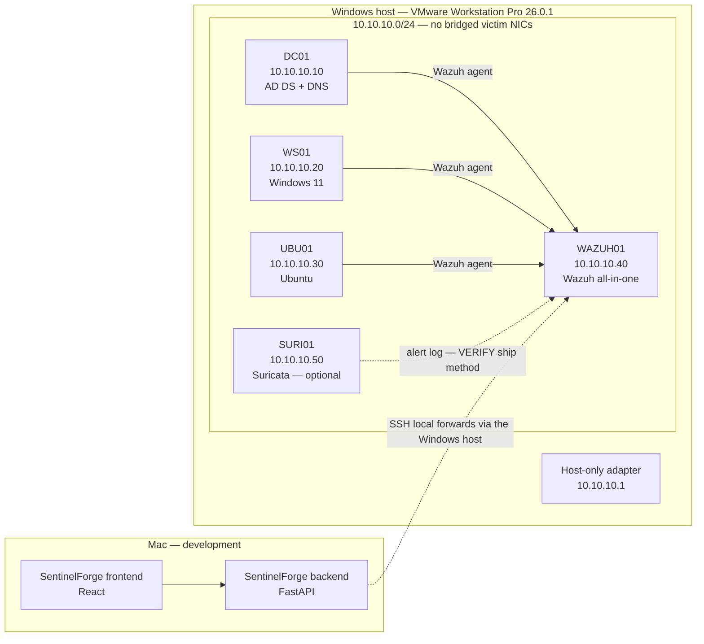
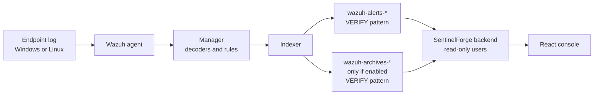

# Architecture

Docs only. No component here has been installed or measured. Sizing is a plan for the hardware below.

**REQUIRES WINDOWS VALIDATION** for every VMware, Windows, and live-lab item in this file.

## Lab host

| Item | Value |
|---|---|
| Machine | Windows PC that runs VMware. It is not a lab VM. |
| CPU | Intel Core i7-13700F, 16 cores / 24 threads |
| RAM | 32 GB |
| Storage | 1 TB SSD |
| Host OS | Windows 10 Home 64-bit. It no longer receives security updates. |
| Hypervisor | VMware Workstation Pro 26.0.1 |
| Domain | `sentinelforge.lab` |
| Subnet | `10.10.10.0/24` |
| Host-only adapter | `10.10.10.1` (gateway on the Windows host, not a VM) |

The host does not join `sentinelforge.lab`. Windows 10 Home is out of support, so the lab stays off the home LAN.

## Diagram

## Network

### Lab segment

Use a VMware **host-only** network, or a **LAN segment**, for `10.10.10.0/24`.

| Rule | Plan |
|---|---|
| Victim and sensor VMs | One NIC on `10.10.10.0/24` only. No bridged NIC. |
| Addresses | Static. Do not use VMware DHCP for lab servers. |
| DNS | VMs use DC01 `10.10.10.10`. The host adapter `10.10.10.1` is not DNS. |
| Gateway | `10.10.10.1` is the Windows host's virtual adapter. It is not an internet router. |
| Home LAN | No lab VM is bridged onto it. |

**REQUIRES WINDOWS VALIDATION:** the VMnet name in Workstation Pro 26.0.1, and that each VM's NIC is host-only after creation. **VERIFY** the product's current name for "LAN segment" versus host-only.

### Updates without leaving the lab bridged

Windows and Ubuntu still need patches. Plan a second NIC that exists only during that window:

1. Snapshot the VM (`pre-update`).
2. Add a VMware **NAT** adapter. NAT egresses through the Windows host. It is not a bridged connection to the home LAN.
3. Install updates. Do not run attack simulations while NAT is attached.
4. Remove or disconnect the NAT adapter.
5. Confirm the VM has only the host-only NIC and can ping `10.10.10.40` but not the internet.
6. Snapshot again (`post-update-no-nat`).

Tradeoff: NAT is safer than bridged mode because the guest is not on the home subnet, but the guest can still reach the internet through an out-of-support host. A compromised guest could download tools or call out during that window. Keep the window short. The host firewall should not publish lab ports on the home NIC while NAT is attached.

**REQUIRES WINDOWS VALIDATION.** **VERIFY** the NAT VMnet name on this Workstation install (often `VMnet8` on older builds; do not assume that name).

### How the Mac reaches WAZUH01

The Mac is a separate computer. Host-only `10.10.10.0/24` exists only on the Windows PC. The Mac cannot ARP for `10.10.10.40`.

| Option | What it does | Isolation |
|---|---|---|
| A. Publish Wazuh on the Windows host | Port-forward dashboard, API, and indexer to the host's home-LAN address. | Weakest. Those ports sit on the home network unless a firewall allows only the Mac. |
| B. SSH tunnel | Mac SSHs to the Windows host. Local forwards land on `10.10.10.40`. Wazuh stays on host-only. | Stronger. The home LAN sees SSH to the host, not Wazuh. |
| C. Backend inside the lab | Run the SentinelForge API on the Windows host or a VM. The Mac talks only to that API. | Strong if the API is the only published port. More to deploy before the app exists. |

**Recommendation: B while developing on the Mac.** Frontend and backend stay on the Mac. The backend's `.env` points at localhost forwards, not at a home-LAN IP.

Planned forwards (destination is WAZUH01):

| Local on the Mac | Remote | Use |
|---|---|---|
| `127.0.0.1:55000` | `10.10.10.40:55000` | Wazuh manager API. **VERIFY** port on 4.14.9. |
| `127.0.0.1:9200` | `10.10.10.40:9200` | Indexer. **VERIFY** port on 4.14.9. |
| `127.0.0.1:443` | `10.10.10.40:443` | Dashboard in a browser. **VERIFY** port on 4.14.9. |

The Windows host can reach `10.10.10.40` because it owns `10.10.10.1`. The SSH listener on the host should allow the Mac's address only. Do not put Wazuh's API or indexer on the home NIC.

Option C is the fallback if SSH to this Windows 10 host is a bad idea in practice. The host no longer gets security updates, so the tunnel ends on an unpatched OS. That is an accepted lab limit: the host is a jump box, it is not a trusted production bastion, and Wazuh credentials stay in `.env` on the Mac.

**REQUIRES WINDOWS VALIDATION** before calling the path working.

## VM plan

Start from this table. Change a size only for the reason in the notes.

| Hostname | OS | Role | IP | vCPU | RAM | Disk | Telemetry it produces |
|---|---|---|---|---|---|---|---|
| WAZUH01 | Ubuntu Server 24.04 LTS | Wazuh 4.14.9 manager, indexer, dashboard | `10.10.10.40` | 4 | 8 GB | 100 GB | Manager logs, indexer logs, alerts, archives when enabled |
| DC01 | Windows Server 2022 or 2025 Evaluation | AD DS, DNS | `10.10.10.10` | 2 | 4 GB | 60 GB | Security, System, Sysmon, PowerShell, Directory Service |
| WS01 | Windows 11 Enterprise Evaluation | Domain workstation, attack target | `10.10.10.20` | 2 | 4 GB | 80 GB | Security, System, Sysmon, PowerShell |
| UBU01 | Ubuntu Server 24.04 LTS | Linux endpoint | `10.10.10.30` | 2 | 2 GB | 30 GB | auth log / journal, auditd |
| SURI01 | Ubuntu Server 24.04 LTS | Suricata. Off unless a stretch test needs it. | `10.10.10.50` | 2 | 2 GB | 30 GB | Suricata eve alerts. **VERIFY** ship path into Wazuh. |

OS choice details and **VERIFY** items live in `docs/VERSIONS.md`.

### Why these sizes

| Choice | Reason |
|---|---|
| WAZUH01 at 4 / 8 GB / 100 GB | User's starting point. RAM is the scarce resource on a 32 GB host, so this VM does not get more vCPU. |
| DC01 at 2 / 4 GB / 60 GB | User's starting point. A single-domain lab DC does not need more on day one. |
| WS01 at 4 GB, not 6 GB | User allowed 4–6 GB. 4 GB keeps host RAM above the 10 GB floor even if SURI01 is powered on. Move to 6 GB only if Windows 11 is unusable, and keep SURI01 off in that case. |
| UBU01 and SURI01 at 2 / 2 GB / 30 GB | User's starting point. SURI01 is optional. |
| CPU total | Always-on guests use 10 vCPU on a 16-core host. With SURI01, 12. No change required for CPU. |

### RAM budget

Leave at least **10 GB** for the Windows host.

| Set powered on | Guest RAM | Left for the host |
|---|---|---|
| WAZUH01 + DC01 + WS01 (4 GB) + UBU01 | 18 GB | 14 GB |
| Same, WS01 raised to 6 GB, SURI01 off | 20 GB | 12 GB |
| Base set plus SURI01, WS01 still at 4 GB | 20 GB | 12 GB |
| WS01 at 6 GB and SURI01 on | 22 GB | 10 GB |

The last row meets the floor and has no spare guest RAM. Do not add another VM there.

### Wazuh 4.14.9 hardware minimum

| | vCPU | RAM | Disk |
|---|---|---|---|
| This lab's plan for the all-in-one VM | 4 | 8 GB | 100 GB |
| Published minimum for Wazuh 4.14.9 | **VERIFY** | **VERIFY** | **VERIFY** |

Check the official 4.14 requirements page on install day. This plan is not a claim that 8 GB meets or beats the vendor minimum.

### WS01 virtual TPM

Windows 11 on VMware needs a virtual TPM. Workstation encrypts the VM when a TPM is added. **REQUIRES WINDOWS VALIDATION** on Workstation Pro 26.0.1.

- Encrypt WS01 and store the encryption password in a password manager.
- Do not commit that password, and do not put it in a snapshot note inside the repo.
- **VERIFY** the exact Workstation 26 dialog (full VM encryption versus partial).

DC01 uses a Windows Server evaluation. A vTPM is a Windows 11 guest requirement for WS01, not a reason to encrypt every VM.

### Indexer heap inside 8 GB

WAZUH01's 8 GB is shared by Ubuntu, the manager, the dashboard, and the indexer. The indexer is OpenSearch. If its JVM heap takes half of 8 GB, the rest of the stack is starved.

Lab plan: cap the indexer heap low enough that the OS and the other Wazuh processes still fit. A planning target is **2 GB** for both minimum and maximum heap. That number is a lab choice, not a measured vendor default.

**VERIFY** for 4.14.9 before editing anything:

- File path (candidates seen on older 4.x installs: `/etc/wazuh-indexer/jvm.options` and `jvm.options.d/`).
- Setting names (candidates: `-Xms` and `-Xmx`).
- Whether a Wazuh install script resets those values on upgrade.

### Disk growth and retention

Alert indices and archive indices do not grow at the same rate.

| Index pattern | What it holds | Lab plan |
|---|---|---|
| `wazuh-alerts-*` | Alerts that rules produced | Keep. **VERIFY** the 4.14.9 pattern name. |
| `wazuh-archives-*` | Raw events, only if archives indexing is on | Off until a hunt needs raw events. **VERIFY** the pattern name and the manager setting that enables it. |

No events have been ingested, so there is no GB-per-day figure. Do not invent one.

Retention plan:

- Leave archives indexing off during install.
- Turn it on only for a hunt or a validation pass, then watch the 100 GB disk.
- Prefer a short archives window (days, not a copied production policy). **VERIFY** the 4.14.9 index-management mechanism before writing a policy.
- Keep alerts longer than archives. Exact day counts wait until real volume is visible.
- Snapshots sit outside the disk column above. Keep one clean snapshot per VM and delete stale ones so the 1 TB SSD stays usable.

## Data flow

| Hop | Owner | Notes |
|---|---|---|
| Endpoint log | Guest OS | Security, Sysmon, PowerShell, auth, auditd. Suricata is optional. |
| Agent → manager | Wazuh | Agent version must match 4.14.9. |
| Decoders and rules | Wazuh | Custom rules live in this repo and are copied to the manager later. |
| Indexer | Wazuh | Source of truth for alerts and, when enabled, raw events. |
| Backend | SentinelForge | Read-only API user and read-only indexer user. Writes incidents to SQLite. |
| Console | SentinelForge | Talks only to the backend. It never holds Wazuh credentials. |

## Ownership

| Wazuh owns | SentinelForge owns |
|---|---|
| Log collection and agents | Incidents, status, owner, disposition |
| Decoders | Analyst notes |
| Detection rules and the alert decision | Correlation across alerts into a case |
| Alert storage in the indexer | Explainable risk scores |
| Manager, indexer, and dashboard uptime | Hunt UI and saved-hunt definitions |
| Built-in dashboard for administration | Validation status shown to the analyst |

An alert in Wazuh is not an incident. An incident exists when the backend correlates alerts or an analyst promotes a hunt.

## Lab security

| Control | Plan |
|---|---|
| Isolation | Host-only or LAN segment. No bridged victim VM. Host is out of support, so this is mandatory. |
| Snapshots | Take one before every simulation and before adding the temporary NAT adapter. |
| API users | Backend uses a read-only Wazuh API user and a read-only indexer user. Admin credentials stay off the Mac app. |
| Secrets | `.env` only. `.env.example` has placeholders. Nothing secret is committed. |
| Simulations | Lab guests only, cleanup script beside each simulation, `-IUnderstandLabOnly` when those scripts exist. |
| Response actions | Later, labeled `LAB ONLY`, dry-run unless an explicit approve call is made. |

**REQUIRES WINDOWS VALIDATION:** isolation, snapshots, and read-only users are untested until the lab exists.
